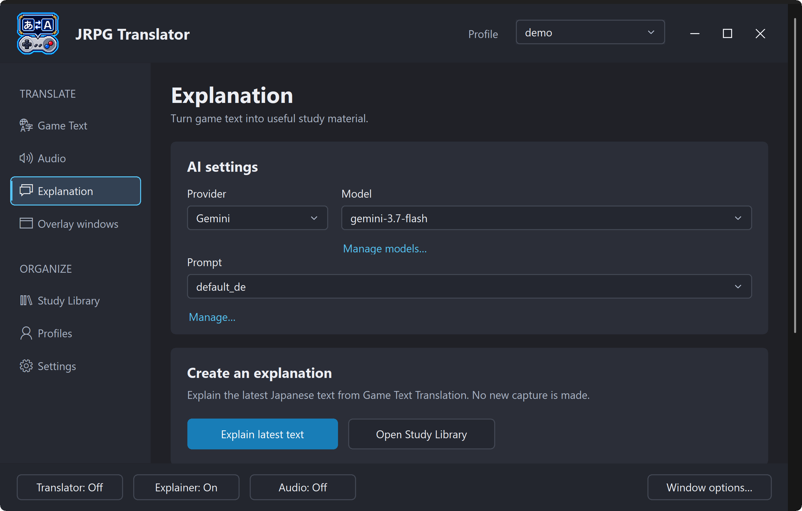
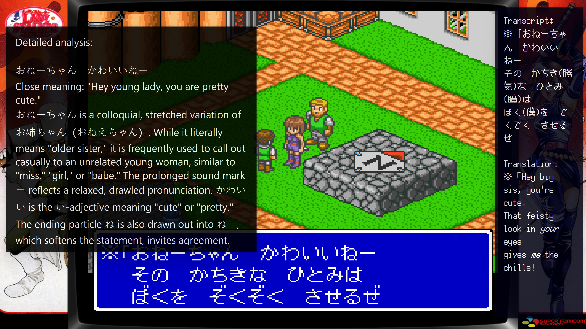
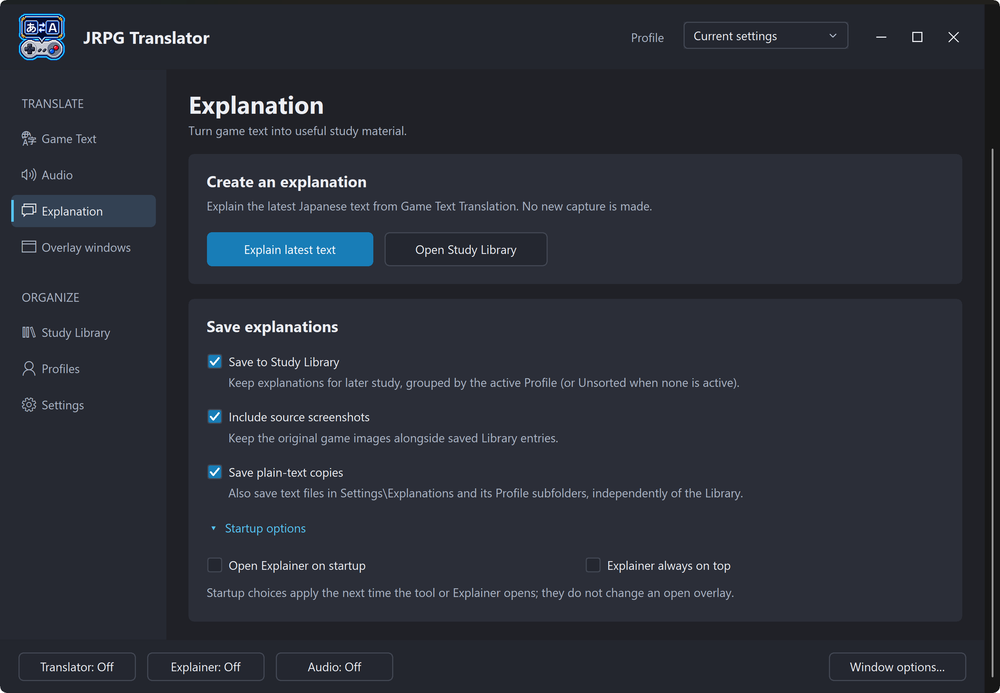

# 6. Explanation

[← Audio Translation](05-audio-translation.md) · [Contents](README.md) · [Next: Overlay windows →](07-overlay-windows.md)

## What the Explainer explains

The Explainer is an optional learning assistant for Japanese text obtained through Game Text Translation. A suitable prompt can ask for vocabulary, readings, grammar, sentence structure, meaning, and nuance.

It uses its own provider, model, and prompt. A fast translation model and a different explanation model can therefore be used together.

**Explain last text does not take a new screenshot.** It uses the latest available Japanese source from the image-translation workflow. If you have advanced the game since the last capture, capture and translate the new line first.

## Create your first explanation

1. On **Game Text**, choose a transcript-aware prompt.
2. Capture and translate a dialogue line.
3. Open **Explanation**.
4. Choose its **Provider**, **Model**, and **Prompt**.
5. Choose **Detailed explanation**, or use the configured explanation action.
6. Read the response in the Explainer overlay.

If no Japanese source is available, check the translation prompt and output format rather than repeatedly requesting explanations. A translation-only response may not provide the source the Explainer needs.

*Figure S10a. Explanation AI settings and actions. Explain last text uses the latest Japanese source from Game Text Translation; Open Study Library opens previously saved study material.*

*Figure S11. The Explainer breaks down the latest Japanese source while the Translator shows the transcript and translation. This is a real output example, not a guarantee of AI accuracy.*

## Quick explanations during play

For a shorter answer, use **Quick explanation** on the same Explanation page. Its
bundled prompt asks for a small vocabulary list with readings and meanings, plus
the key grammar needed to understand the current dialogue. Both actions use the
latest translated source and display their result in the same Explainer overlay.
The Quick result is labeled and has its own ready notification.

Quick has a separate **Prompt** selector and **Manage…** menu. Its bundled
`default_*` prompts support English, German, Spanish, French, Italian, Japanese,
Korean, Dutch, Polish, Portuguese, Russian, Ukrainian, Simplified Chinese, and
Traditional Chinese—the same languages as Detailed explanations. Choose the
desired language here in the desktop UI or Big Box's Quick row; for example,
`default_de` gives German vocabulary meanings and grammar explanations.

Edit a prompt's language or detail level, or create another prompt; keep `{jp}` where the Japanese
source should appear. Under **Model options**, leave **Use detailed explanation
model** enabled, or turn it off to choose a separate provider and model. Add models
through **Manage models…** in the Detailed section above.

Quick explanations are never saved to the Study Library or plain-text archives.
The saving options below apply to Detailed explanations. Generating Quick does not
change those preferences or the Detailed prompt and model. A shorter response can
finish sooner, but response time still depends on the provider, model, and input.

In **Settings → Controls**, assign **Quick explanation** a keyboard shortcut or
direct controller button. It starts unassigned; your existing explanation binding
continues to request Detailed explanations. With JoyToKey, you can map a short
press to Quick and a long press to Detailed, using two different keyboard shortcuts.
See [controls and JoyToKey](03a-controls-and-shortcuts.md#use-joytokey-for-short-and-long-presses).

Only one gameplay explanation runs at a time. Requesting the other kind while one
is running leaves the current request in progress. Quick requests allow up to two
minutes at the provider; Detailed requests retain their five-minute allowance.
The interface allows another 45 seconds for startup and finishing the result.

## Detailed and Quick in Big Box

The dashboard header shows separate **Detailed explanation** and **Quick
explanation** rows, each with its effective provider, model, and prompt.

Open **Explanation AI** from Home to configure both kinds in separate rows.
In the Quick row, choose **Provider → Use detailed model** to share the Detailed
provider and model, or choose Gemini / OpenAI to use an independent Quick model.
The Quick prompt stays separate in either case. Model and prompt selection screens
also provide their management controls. These settings are shared with the desktop UI.

The full **Explanation** page, reached with LB / RB, L1 / R1, or the page arrows,
also includes separate **Detailed explanation** and **Quick explanation** buttons.
Its **Detailed saving** controls apply only to Detailed results; Quick results are
never saved to the Study Library or plain-text archives.

## Explain versus show/hide

Showing the Explainer window and requesting an explanation are different actions. The Controls list includes a show/hide action as well as explanation-request actions, including **Launch Explainer + request**.

If you only want to reread the current explanation, show the overlay instead of sending another AI request. New requests can incur additional provider usage.

## If an explanation fails

A timeout, unavailable model, or other request failure shows a 15-second, non-blocking notice at the top left of the foreground application's monitor, even when the Explainer is hidden. Ordinary saved/toggled notices do not replace it. A Windows warning sound also plays if system sounds are enabled. No background popup needs to be dismissed before you can continue using the app.

The failure summary remains on the desktop **Explanation** page and the Big Box **Explanation** / **Explanation AI** pages until you start another request. Show the Explainer overlay for full details. A **504 / DEADLINE_EXCEEDED** means the request timed out; it does not necessarily mean the model no longer exists. Try again later or choose another explanation model. Requests are not retried automatically.

Exclusive fullscreen can cover ordinary desktop notifications. If you cannot see these notices over your game, use borderless/windowed mode and check the retained status when returning to the control center.

## Customize the explanation prompt

Use the prompt **Manage...** menu to edit, create, or delete an explanation prompt. These prompts are separate from Game Text prompts.

Useful adjustments include the language used for explanations, how much grammar terminology is assumed, or how concise the response should be. Start from a bundled prompt and change it gradually.

If you plan to use the Study Library and vocabulary tools, retain the structured sections expected by the bundled explanation format. Replacing the format with a completely free-form essay can make section extraction and vocabulary presentation less useful.

Model explanations can be plausible but wrong. Check important points against the original sentence and reliable language references; a recommendation score is not a grammatical correctness guarantee.

## Decide what to save

| Option | What it does |
| --- | --- |
| Save to Study Library | Saves explanations for later searching and study in the selected Library |
| Include source screenshots | Keeps original game images with saved Library entries; depends on Library saving |
| Save plain-text copies | Also saves text files independently of the Library |

Library entries are associated with the active JRPG Translator Profile, or **Unsorted** when there is no active Profile. This Profile metadata is not the same as the selected Library's name.

Choose the intended Library before generating material. If you want the choice recalled for a game, save it in that game's Profile.

Plain-text copies are stored under `Settings\Explanations` and its Profile subfolders. They are useful for independent reading or backups but are not a replacement for the Library database and its metadata.

The saving options control future output. Disabling one does not delete explanations or screenshots already saved.

*Figure S10b. Choose which explanation outputs to keep. The expanded startup options control whether the Explainer opens on startup and stays on top when it next opens.*

## Startup options

The Explanation page's startup controls determine whether the Explainer should open and whether it should open always on top. These choices apply when the tool or Explainer next opens; they do not necessarily alter an already-open overlay.

Use [Overlay windows](07-overlay-windows.md) for current appearance and placement, and [Profiles](09-profiles.md) to save game-specific startup/overlay preferences.

## Continue studying later

Choose **Open Study Library** to browse saved material without returning to the original game scene. The reader can display saved versions, source screenshots, and extracted sections. You can later generate another explanation version, review study candidates, or create an Anki card.

Those later AI requests and Anki writes are explicit actions; simply opening the Library does not require regenerating your explanations.
